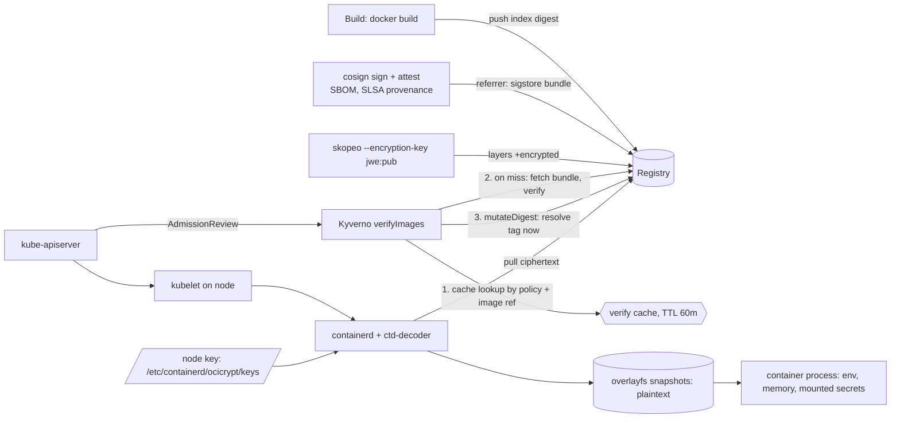

The pod that got through my admission policy said `EVIL secret-len=16`.

That string is mine. I put it in a deliberately bad build of a tiny Go service, pushed it to
my registry unsigned, and pointed the `:v1` tag at it. The policy in front of the cluster
requires a cosign signature, a CycloneDX SBOM and a SLSA provenance attestation from my key
before any image runs in `prod`. It had denied that exact image, by digest, a few seconds
earlier. Then it let it in under the tag, pinned it to the evil digest, and the kubelet started
it with the production secret in its environment.

Nothing errored. The policy reported Ready the whole time.

This is the first of two posts about a question I keep getting from teams hardening their
Kubernetes supply chain: once you sign everything and encrypt the layers, what is actually left
to protect? I built the whole stack on a Kind cluster and asked three things:

1. **Does admission enforcement block what it claims to?** Unsigned images, tampered
   signatures, a repointed tag, a registry outage. How many get through, and what does
   verification cost per pod?
2. **What does layer encryption buy you?** A stolen copy of the registry, a node that doesn't
   hold the key, and the pull/start overhead compared with a plain image.
3. **What does root on one node get an attacker?** Decrypted image contents, process secrets,
   memory, the decryption key itself. Exact commands, timed.

Same rule as last time: **if I didn't observe it, it isn't here.** Scripts and raw output are in
[`docs/labs/signed-encrypted-images-node-root/`](https://github.com/netf/blog/tree/main/docs/labs/signed-encrypted-images-node-root),
and `./reproduce.sh` rebuilds everything from a blank VM.

Part 2 is about the obvious answer to question 3, confidential containers and TEEs. I meant to
test them here and couldn't; the methodology section says why in two lines.

## How the pieces fit

Signing and encryption protect different hops, and neither one protects the node itself:

Admission decides *whether* a pod may run, using signatures fetched from the registry.
Encryption decides *who* can read the layers on the way to the node. Once containerd has
decrypted them, the plaintext lives on the node's disk and in the process, next to the key that
decrypted it. Steps 1 and 3 in the diagram are where the surprise below comes from.

## The lab

One Kind cluster (`supply`: a control plane and two workers, Kubernetes v1.37.0, containerd
2.3.4) on a 4-vCPU VM, plus a plain-HTTP `registry:2.8.3` on the Kind network at
`kind-registry:5000`. The same name resolves on the host, on the nodes and inside pods, which
matters because Kyverno fetches signatures from inside a pod.

- **The app** is a 5.8 MB (5,767,330-byte) static Go binary in a `scratch` image, plus an 8 MiB "proprietary
  model" file whose first line is `PROPRIETARY-MODEL-MARKER-7f3a9c`. That marker is how I check
  later whether someone can read the image. The app copies `APP_SECRET` from its environment
  into a package variable, so the secret also lives in its heap.
- **Signing:** cosign v3.1.3 with a local key pair, no Fulcio and no Rekor. syft v1.54.1 makes
  the CycloneDX SBOM; the SLSA v1 provenance predicate is hand-written and names a builder ID
  the policy checks.
- **Admission:** Kyverno v1.19.1 (chart 3.9.1), one `ClusterPolicy` scoped to namespace `prod`
  that requires the signature and both attestations and rewrites tags to digests.
- **Encryption:** skopeo 1.13.3 `--encryption-key jwe:` (RSA-4096) and imgcrypt v2.0.3's
  `ctd-decoder` as containerd's stream processor, with the private key on `supply-worker` only.
- **The attacker** in part 3 is `docker exec supply-worker`, which on Kind is the same thing as a
  root shell on the node.
