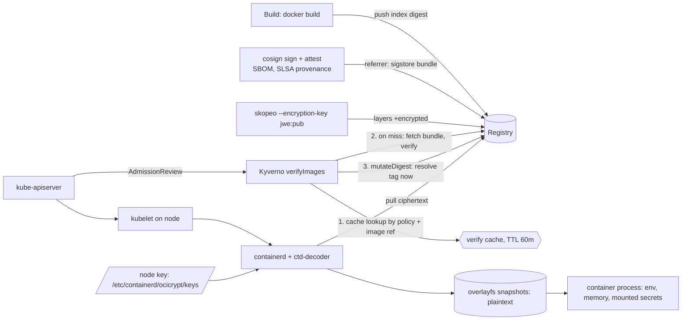

The pod that got through my admission policy said `EVIL secret-len=16`.

That string is mine. I put it in a deliberately bad build of a tiny Go service, pushed it to
my registry unsigned, and pointed the `:v1` tag at it. The policy in front of the cluster
requires a cosign signature, a CycloneDX SBOM and a SLSA provenance attestation from my key
before any image runs in `prod`. It had denied that exact image, by digest, a few seconds
earlier. Then it let it in under the tag, pinned it to the evil digest, and the kubelet started
it with the production secret in its environment.

Nothing errored. The policy reported Ready the whole time.

This is the first of two posts about a question I keep getting from teams hardening their
Kubernetes supply chain: once you sign everything and encrypt the layers, what is actually left
to protect? I built the whole stack on a Kind cluster and asked three things:

1. **Does admission enforcement block what it claims to?** Unsigned images, tampered
   signatures, a repointed tag, a registry outage. How many get through, and what does
   verification cost per pod?
2. **What does layer encryption buy you?** A stolen copy of the registry, a node that doesn't
   hold the key, and the pull/start overhead compared with a plain image.
3. **What does root on one node get an attacker?** Decrypted image contents, process secrets,
   memory, the decryption key itself. Exact commands, timed.

Same rule as last time: **if I didn't observe it, it isn't here.** Scripts and raw output are in
[`docs/labs/signed-encrypted-images-node-root/`](https://github.com/netf/blog/tree/main/docs/labs/signed-encrypted-images-node-root),
and `./reproduce.sh` rebuilds everything from a blank VM.

Part 2 is about the obvious answer to question 3, confidential containers and TEEs. I meant to
test them here and couldn't; the methodology section says why in two lines.

## How the pieces fit

Signing and encryption protect different hops, and neither one protects the node itself:



Admission decides *whether* a pod may run, using signatures fetched from the registry.
Encryption decides *who* can read the layers on the way to the node. Once containerd has
decrypted them, the plaintext lives on the node's disk and in the process, next to the key that
decrypted it. Steps 1 and 3 in the diagram are where the surprise below comes from.

## The lab

One Kind cluster (`supply`: a control plane and two workers, Kubernetes v1.37.0, containerd
2.3.4) on a 4-vCPU VM, plus a plain-HTTP `registry:2.8.3` on the Kind network at
`kind-registry:5000`. The same name resolves on the host, on the nodes and inside pods, which
matters because Kyverno fetches signatures from inside a pod.

- **The app** is a 5.8 MB (5,767,330-byte) static Go binary in a `scratch` image, plus an 8 MiB "proprietary
  model" file whose first line is `PROPRIETARY-MODEL-MARKER-7f3a9c`. That marker is how I check
  later whether someone can read the image. The app copies `APP_SECRET` from its environment
  into a package variable, so the secret also lives in its heap.
- **Signing:** cosign v3.1.3 with a local key pair, no Fulcio and no Rekor. syft v1.54.1 makes
  the CycloneDX SBOM; the SLSA v1 provenance predicate is hand-written and names a builder ID
  the policy checks.
- **Admission:** Kyverno v1.19.1 (chart 3.9.1), one `ClusterPolicy` scoped to namespace `prod`
  that requires the signature and both attestations and rewrites tags to digests.
- **Encryption:** skopeo 1.13.3 `--encryption-key jwe:` (RSA-4096) and imgcrypt v2.0.3's
  `ctd-decoder` as containerd's stream processor, with the private key on `supply-worker` only.
- **The attacker** in part 3 is `docker exec supply-worker`, which on Kind is the same thing as a
  root shell on the node.

## 1. Admission: what the policy actually blocks

### First, my correctly signed image was rejected

cosign v3 changed where signatures go. `cosign sign` now writes a Sigstore bundle
(`application/vnd.dev.sigstore.bundle.v0.3+json`) as an OCI 1.1 *referrer* of the image. My
`registry:2.8.3` has no referrers API, so cosign fell back to a tag named after the digest,
`sha256-<digest>`, with no `.sig` suffix. cosign itself verified the signature and both
attestations without complaint.

Kyverno, with the policy's `type` left at its default (`Cosign`), denied the image:

```text
failed to verify image kind-registry:5000/demo/app:v1:
.attestors[0].entries[0].keys: no signatures found
```

Setting `cosignOCI11: true` (described in the CRD as "the experimental OCI 1.1 behaviour")
produced the same error. What worked was `type: SigstoreBundle` on the `verifyImages` entry.
To make sure that wasn't a policy accepting anything, I changed the expected builder ID in the
provenance condition and the same image was denied with
`image attestations verification failed, verifiedCount: 0, requiredCount: 1`.

This failure is the safe kind: a format mismatch fails closed. But if you upgrade cosign in CI
and not your policies, every newly signed image is denied, and the error message points at your
signatures rather than at the policy.

### The attack matrix

With `type: SigstoreBundle`, I threw the obvious attacks at it. Each row is one `kubectl run` in
`prod` (`results/admission/attacks.tsv`):

| Attempt | What the attacker did | Result |
|---|---|---|
| Signed image by tag | nothing (control) | allowed |
| Signed image by digest | nothing (control) | allowed |
| Unsigned image by tag | pushed `:evil`, never signed | **denied** |
| Unsigned image by digest | same image, `@sha256:` | **denied** |
| Transplanted signature | copied v1's valid bundle onto an unsigned image's referrer tag (raw manifest `GET` + `PUT`, HTTP 201) | **denied**: `sigstore bundle verification failed: no matching signatures found` |
| Repointed tag | overwrote `:v1` so it resolves to the unsigned image | **allowed**, pinned to the unsigned digest |
| Signed digest after repoint | `@sha256:` of the real v1 | allowed |

Six of seven rows behave the way the brochure says. The bundle binds the digest it signed, so a
copied signature is useless, and anything referenced by digest can't be swapped underneath you.

The repointed tag is the row from the opening.

### The tag that stayed verified

My first guess was that `85d20…`, the digest in that run, had somehow picked up a valid
signature. `cosign verify` said `no signatures found`. Then I restarted the Kyverno admission
controller and retried the same tag. Denied.

So it was state, and the binary documents it:

```text
-imageVerifyCacheEnabled     Enable a TTL cache for verified images. (default true)
-imageVerifyCacheMaxSize     ... Keys are a combination of policy elements along with
                             the image reference. Default is 1000.
-imageVerifyCacheTTLDuration ... Default is 60m.
```

The cache key is the image reference as written in the pod spec, `kind-registry:5000/demo/app:v1`,
and not the digest it resolved to. When the signed `:v1` is admitted, "verified" is cached against
the string `…/app:v1`. When the tag moves, the next pod with that string hits the cache, skips
verification, and then `mutateDigest` resolves the tag again and pins whatever it points to
*now*. Verification and digest resolution are two separate lookups, and the cache sits between
them.

`scripts/13-repoint-cache.sh` reproduces it: admit `:v1`, repoint `:v1`, keep admitting:

| Kyverno setting | Repointed tag admitted until | First denial |
|---|---|---|
| `imageVerifyCacheTTLDuration=2m` (run 1) | t=104 s | t=124 s |
| `imageVerifyCacheTTLDuration=2m` (run 2) | t=106 s | t=126 s |
| default (60m TTL), polled every 2 min | still admitted at t=483 s, the last poll before the VM went away | not reached |
| `imageVerifyCacheEnabled=false` | never | t=0 s |

The first admitted pod in each run really was the evil build: a probe pod's `wget` of
`/whoami` returned `EVIL secret-len=16`, and the kubelet reported the unsigned digest as its
`imageID`. In the 2-minute runs, a cache hit every 20 seconds did not extend the window; it
closed one TTL after the legitimate `:v1` was verified. So anyone who can push a tag gets up to
an hour (the default TTL) of unverified deploys of that tag after it was last verified.

The fix is one flag, and the chart ate it the first time. Kyverno's chart renders extra args
like this:

```yaml
{{- range $key, $value := .Values.admissionController.container.extraArgs }}
{{- if $value }}
- --{{ $key }}={{ $value }}
{{- end }}
{{- end }}
```

`--set admissionController.container.extraArgs.imageVerifyCacheEnabled=false` makes `$value`
the boolean `false`, the `if` drops it, and the cache stays on. No warning; the repointed tag was
still admitted in that run (`results/repoint-cache/off-bool-dropped-by-chart/`). Pass it as a
string with `--set-string`, then check that `--imageVerifyCacheEnabled=false` is actually in the
container args.

## 2. Encrypted layers: what a stolen registry gets you

`skopeo copy --encryption-key jwe:enc-pub.pem` re-wrote both layers as
`application/vnd.oci.image.layer.v1.tar+gzip+encrypted`. Each layer gets a random symmetric key
(`AES_256_CTR_HMAC_SHA256`, per the layer's `pubopts` annotation), and that key is wrapped with
my RSA public key into a 1,460-character `org.opencontainers.image.enc.keys.jwe` annotation.

Then I played someone who has read access to the registry, or a copy of its storage, and no
private key (`scripts/21-stolen-copy.sh`):

| | plain copy | encrypted copy |
|---|---|---|
| `tar tzf` on each layer blob | lists `demoapp`, `opt/model/model.bin` | `gzip: stdin: not in gzip format` |
| marker found after `gunzip` | 1 | **0** |

The contents are protected as advertised. What's around them isn't:

- **The image config is plaintext, and it's the same blob.** The encrypted image points at the
  identical config digest as the plain one. It shows the entrypoint, the user (`65532:65532`)
  and the build history, including `COPY model.bin /opt/model/model.bin # buildkit`.
- **`diff_ids` are hashes of the plaintext.** The config's `rootfs.diff_ids` equal the SHA-256
  of each *decrypted* layer tar; I checked both against the plain image. If an attacker can guess
  a layer (a public base image, last quarter's model), they can confirm the guess without the key.
- **Sizes are exact.** Ciphertext layers are byte-for-byte the same length as the plaintext ones
  (8,391,419 bytes for the model layer in the final run).

### What verification costs per pod

`scripts/15-latency.sh` times `kubectl create --dry-run=server` for a pod. Dry-run runs the
whole admission chain, verification and digest mutation included; the script aborts if a dry-run
of the unsigned image is *not* denied. 30 samples per case, wall time in ms, local registry:

| Case | p50 | p90 | p99 | max |
|---|---|---|---|---|
| No policy (namespace `default`) | 66 | 70 | 84 | 87 |
| Policy, verify-cache hit | 71 | 76 | 96 | 103 |
| Policy, cache disabled (full signature + 2 attestation checks) | 109 | 117 | 127 | 130 |

So full verification adds about 43 ms at the median against a registry on the same Docker
network. Turning the cache off costs 38 ms per pod over a warm cache. A registry across a WAN
will add its round trips on top, and I didn't test that.
