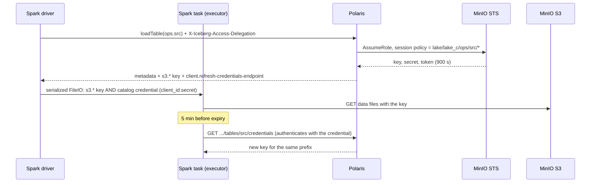

At 11:39:48 a PyIceberg job died with `AWS Error ACCESS_DENIED during HeadObject`, 42 minutes
into a run I had given a 60-minute credential. I'd written down that it would die at minute 61. The
key it was holding had been minted 18 minutes before the job started, for a different principal
(the root user creating tables), and Polaris handed it over from its credential cache with 42
minutes left on it.

That was the first of several things in this lab that didn't go the way the plan said. The plan
itself was simple. A lake where every engine holds one S3 key that can read every table is one
leaked notebook away from a full copy. The Iceberg REST spec has an answer: the catalog vends
short-lived credentials scoped to one table's prefix, plus a
[refresh endpoint](https://iceberg.apache.org/docs/nightly/rest-protocol/) so long jobs survive
the expiry. The folklore says the first long job breaks anyway
([iceberg#13515](https://github.com/apache/iceberg/issues/13515),
[polaris#464](https://github.com/apache/polaris/issues/464),
[iceberg#14634](https://github.com/apache/iceberg/issues/14634)) and teams go back to the shared key.

So I built it: a 300-table lake on MinIO, Polaris 1.9.0 vending through MinIO's STS (Lakekeeper
v0.15.1 as a second catalog), and jobs of 5, 30 and 61 minutes on Spark, Trino, PyIceberg and
DuckDB, in three arms. (I planned 120-minute jobs too. The VM they ran on had other ideas; see the
methodology.)

- **A**: one bucket-wide key per engine, the way most lakes start.
- **B**: vended credentials with every default left alone (Polaris TTL 3600 s, no client settings
  beyond turning vending on, one catalog-wide grant per engine).
- **C**: lakegate: TTL 900 s, grants generated from the audit log, refresh settings pinned, a
  refresh shim for the client that needs one, an escape tester and a canary.

Scripts, raw results and a reproduce command are in
[`docs/labs/lakegate/`](https://github.com/netf/blog/tree/main/docs/labs/lakegate). If I didn't
observe it, it isn't here.

## The short version

- **The shared key is as bad as you think.** Arm A's Spark key read all 300 tables, and still did
  3 hours 29 minutes after I created it.
- A vended key is as good as the spec says. In B and C a stolen key read exactly 1 of 300
  tables. It couldn't list the bucket, write elsewhere, touch the other table's metadata or mint a
  MinIO service account, and it died at its expiry with `InvalidAccessKeyId` (711 s after theft in
  C, 2,328 s in B).
- **But the S3 key isn't the only thing in the job.** Every Spark task's `FileIO` carries the
  catalog `credential`, the principal's client id and secret, so it can call the refresh endpoint.
  With that, the same stolen bag reads 300 of 300 tables in B and 38 of 300 in C, for as long as
  the secret isn't rotated. **Grants set the blast radius, not the TTL.**
- **Refresh works in Spark and DuckDB, half-works in Trino, and doesn't exist in PyIceberg.**
  Trino 484 refreshes its reads but its Parquet writer keeps the key it opened with, so any
  `INSERT` whose writer stays open past the TTL fails at the last step. PyIceberg 0.12.0 dies at
  expiry; a 44-line shim fixes it. I was wrong about DuckDB: it refreshes.
- Polaris' credential cache shares one STS key between principals and can hand a job a
  "60-minute" key with half its life gone. That's what killed the PyIceberg job at minute 42.
- The cost is noise. Arm C jobs took between 0.62% less and 0.03% more time than arm A.
  50 concurrent jobs planning at once saw a `loadTable` p99 of 140 to 154 ms with vending against
  124 to 136 ms without.
- Shared table locations do leak, but only if you turn the guard off. Polaris refuses
  overlapping locations by default. With `allow.overlapping.table.location` on, a table created
  where a renamed one used to live could read and write the old table's files.

## How a vended key gets to a task, and what rides along with it



The catalog calls `AssumeRole` against MinIO with a session policy naming exactly one table's
prefix, and MinIO evaluates every request against it. Here is the policy Polaris sent for a table
in the lab, from MinIO's audit log:

```json
{"Version":"2012-10-17","Statement":[
 {"Effect":"Allow","Action":["s3:PutObject","s3:DeleteObject"],"Resource":["arn:aws:s3:::lake/lake_f/ops/src_spark_5/*"]},
 {"Effect":"Allow","Action":["s3:ListBucket"],"Resource":["arn:aws:s3:::lake"],"Condition":{"StringLike":{"s3:prefix":["lake_f/ops/src_spark_5/*"]}}},
 {"Effect":"Allow","Action":["s3:GetBucketLocation"],"Resource":["arn:aws:s3:::lake"]},
 {"Effect":"Allow","Action":["s3:GetObject","s3:GetObjectVersion"],"Resource":["arn:aws:s3:::lake/lake_f/ops/src_spark_5/*"]}]}
```

The `/` before the `*` matters: `src_spark_5_backup` doesn't match. I checked that with a real
sibling table (`a` and `a_backup`) in Polaris, and `a`'s key couldn't read `a_backup`. Lakekeeper
puts every table at a UUID path, so the question doesn't come up there.

Getting this far took two settings the docs don't put next to each other. Polaris' own
"Creating a catalog on MinIO" page creates the catalog with an endpoint and a region, and the first
`createTable` then fails:

```text
StsException: invalid resource 'arn:aws:kms:us-east-1:000000000000:key/*' (Service: Sts, Status Code: 400)
```

Polaris adds a `kms:*` statement to the session policy unless the catalog says
`"kmsUnavailable": true`, and MinIO's STS rejects the ARN. And setting the TTL to 15 minutes on its
own breaks table creation, because the credential cache defaults to 30:

```text
IllegalArgumentException: STORAGE_CREDENTIAL_CACHE_DURATION_SECONDS should be less than STORAGE_CREDENTIAL_DURATION_SECONDS
```

Lakekeeper v0.15.1 vended MinIO STS credentials with `flavor: s3-compat` and nothing else, placed
every table at a UUID path, and returned an absolute refresh URL. So "does the catalog vend MinIO
STS with refresh out of the box" is yes for Lakekeeper and yes-after-one-flag for Polaris.

## A stolen key: 300 tables forever, or 1 table for 15 minutes

I took one Spark job's credentials in each arm (the job that reads `ops.src_spark_61`) and pointed
an escape tester at the rest of the lake.

| What was stolen | A: bucket key | B: vended, defaults | C: lakegate |
|---|---|---|---|
| S3 key alone: tables readable | 300 of 300 | 1 of 300 | 1 of 300 |
| S3 key alone: usable for | no expiry (still worked after 3 h 29 min) | 2,328 s after theft (key minted 22 min earlier) | 711 s after theft |
| S3 key: write to the table it was vended for | yes | yes (read job, but the principal may write) | no |
| Whole Spark `FileIO` (key + catalog credential): tables readable | 300 of 300 | 300 of 300 | 38 of 300 (262 refused with 403) |
| Whole `FileIO`: usable for | no expiry | until the secret is rotated | until the secret is rotated |

The key-only rows match the hypothesis. "Usable for" was measured, not computed: the tester read
one file every 30 seconds until MinIO answered `InvalidAccessKeyId`, and the last successful read
was 690 s (C) and 2,326 s (B) after the theft. It did that from the host, a different network
namespace from the container that obtained the key, and MinIO accepted it there just the same, so
"reuse from another pod" just works. The rest of the escape suite came back empty for both B and
C keys: no read, list, write or delete on four other tables, `AccessDenied` on the bucket root and
on a write to `elsewhere/`, and `mc admin user svcacct add` with the vended key returned `Access
Denied`, so a key limited by a session policy couldn't mint itself an unlimited one. The one thing
a key could do outside its table was `ListBuckets`, which returned the bucket name.

The last two rows are the part I hadn't planned for.

## The key is short-lived. The thing next to it isn't

A task can only refresh if it can authenticate to the catalog. Iceberg Java solves that by putting
the catalog properties into the table's `FileIO`, and Spark serializes that `FileIO` into every
task. I dumped it from a running session in arm C:

```text
io_class: org.apache.iceberg.io.ResolvingFileIO
client.refresh-credentials-endpoint: v1/lake_c/namespaces/ops/tables/src_spark_5/credentials
credential: <49 chars>        # equal to the principal's client_id:client_secret: true
s3.access-key-id, s3.secret-access-key, s3.session-token, s3.session-token-expires-at-ms
uri: http://polaris-c:8181/api/catalog
```

So the realistic theft (a compromised executor, or a task serialized into a debug log) doesn't get
"a key for one table for 15 minutes". It gets the principal. Polaris 1.9.0 client
secrets have no expiry; I found no expiry field in `PolarisPrincipalSecrets`, only rotation, and
arm B's Spark credential still got a token and a working key 3 hours 26 minutes after I created it.

That changes what the TTL is for. In arm B the principal had the usual catalog-wide
`TABLE_WRITE_DATA`, and the bag reached all 300 tables. In arm C the principal had only the 38
tables the audit log showed Spark touching, and the catalog refused the other 262. **The 15-minute
TTL protects you when only the key leaks; the grants protect you when the job leaks.** If I had to
pick one, I'd do the grants first.

## Who refreshes: one engine of four needs help, one half-works

Every job here has the same shape: read one data file a minute from its source table, then write
the rows to a target table and commit. A "61-minute" job reads 61 files. The tables, and their
credentials, are loaded once at planning.

| Engine | Duration | A (static key) | B (vended, defaults) | C (lakegate, TTL 900 s) |
|---|---|---|---|---|
| Spark 4.1.4 | 5 / 30 / 61 | ok / ok / ok | ok / ok / ok | ok / ok / ok |
| Trino 484 | 5 / 30 / 61 | ok / ok / ok | ok / ok / **fail at 63.8 min** | ok / **fail at 31.3** / **fail at 63.8** |
| PyIceberg 0.12.0 | 5 / 30 / 61 | ok / ok / ok | ok / ok / **fail at 42.3** | ok / ok / ok (shim) |
| DuckDB 2.0.1 | 5 / 30 / 61 | ok / ok / ok | ok / ok / ok | ok / ok / ok |

(A "30-minute" job took 31.3 minutes in every arm and a "61-minute" one 63.8; see the methodology
for why.) Against Lakekeeper, with a 900 s TTL and 20-minute jobs, each engine behaved the same way:
Spark, DuckDB and PyIceberg with the shim passed, plain PyIceberg died at 15.0 minutes, and Trino's
writer failed at the end.

**Spark** refreshes reads and writes. One 61-minute job in arm C used six successive read-only keys
for its source, each about 11 minutes apart, and a separate key with `PutObject` and `DeleteObject`
for its target, first used at 12:01:29, the second it started writing. That's also the answer to "how
does a MERGE from A into B get credentials": one key per table, each with that table's access
level.

**Trino** is the one that surprised me. Its reads refresh; the audit log shows the source of a
30-minute job read with a new key at 11:14, 11:25 and 11:35. Its writer doesn't. The Parquet writer
opens its output file at the start, and the final `PutObject` goes out with the key it had then:

```text
HIVE_WRITER_CLOSE_ERROR: Error committing write to Parquet file
  java.io.IOException: Put failed for bucket [lake] key [lake_c/ops/tgt_trino_30/data/...parquet]:
  S3Exception: The Access Key Id you provided does not exist in our records. (Service: S3, Status Code: 403)
```

It failed the same way against Lakekeeper, so it isn't a Polaris quirk. My jobs are the worst case
here: one row a minute means one file stays open for the whole job. A Trino job that fills and
closes files quickly probably never holds a writer that long. I didn't test file rolling, so the
rule I'd write down is narrower: **in Trino 484, no single output file may stay open longer than
the credential's remaining life.**

**PyIceberg** 0.12.0 has `RestCatalog.load_credentials()`, but nothing in its `FileIO` calls it, so
a job keeps the key it got at load time. At a 900 s TTL every PyIceberg job longer than 15 minutes
died at 15.0 minutes. lakegate's fix is a wrapper (`kit/lakegate_client.py`) that checks the expiry
before every `new_input`/`new_output` and re-fetches from `/credentials` inside the same 5-minute
window Iceberg Java uses. With it, PyIceberg passed every C job and the canary. The shim is mine, not
PyIceberg's, and it shows in the failure tests below: it blocks while the catalog is unreachable and
gives up as soon as the catalog answers with an error.

**DuckDB**: I was wrong. Reading the source of the shipped iceberg extension that morning, I
concluded it never calls the refresh endpoint. My search excluded the line that does
(`ReVendVendedCredentials` calls `IRCAPI::GetTableCredentials` when a secret expires). In the lab it
called `GET .../tgt_duckdb_30/credentials` right before writing, passed every job in B and C, kept a
session working when a new statement ran 1,020 s after the first, and committed a transaction that
sat open for 17 minutes. One caveat on my job shape: DuckDB read all of its source files at the start,
even with `threads=1`, so only the write happened after the TTL.

## The cache that hands out half-used keys

Back to the job that died at minute 42. Polaris keeps vended credentials in a cache for
`STORAGE_CREDENTIAL_CACHE_DURATION_SECONDS` (default 1800) and its cache key is the set of locations
and actions, not the principal. MinIO's audit log tells the story of one STS key, `R9B68R4998`:

```text
10:39:40  minted for root, appending to lake_b/ops/src_pyiceberg_61 during setup (exp 11:39:40)
10:57:30  served from cache to principal pyiceberg_b, the 61-minute job, reads every minute
11:00:08  served from cache again, to my escape test using principal spark_b's credential
11:38:48  last successful read
11:39:48  job dies: ACCESS_DENIED during HeadObject
```

So on defaults a key can already be up to 30 minutes old when a job receives it, which leaves
TTL minus cache, 30 minutes, not 60. Three principals held the same write-capable key, which is a
strange thing to call per-table credentials, and it also means MinIO's audit log can't tell you
which one used it. Polaris documents the trade-off on
`INCLUDE_PRINCIPAL_NAME_IN_SUBSCOPED_CREDENTIAL` (off by default): turning it on "leads to degradation in temporary credential caching as catalog will no
longer be able to reuse credentials for multiple principals". I'd turn it on. I didn't measure the
cost of doing that.

## When the catalog, STS or the table name goes away

All of these ran on a separate Polaris with the arm C settings (TTL 900 s), 30-minute jobs, Spark,
Trino and PyIceberg with the shim.

| Failure | Spark | Trino | PyIceberg + shim |
|---|---|---|---|
| Catalog unreachable minute 2 to 23 | died at 15.1 min (key expiry) | died at 10.0 min (first refresh) | blocked in refresh, resumed when the catalog came back, finished at 43.5 min |
| Catalog unreachable minute 8 to 14 | **survived** (30.1 min) | died at 10.0 min | blocked 5 min, resumed, finished at 34.0 min |
| STS unreachable minute 2 to 22 | died at 15.9 min (key expiry) | died at 10.6 min | died at 10.0 min |
| Source renamed at minute 2 | died at 15.1 min (`404 NoSuchTableException` on refresh) | died at 10.0 min | died at 10.0 min |

With STS down, Polaris itself stays up and answers the refresh with an error (`ServerError:
SdkClientException: Received an UnknownHostException`) once its cached credential for that table
runs out. Nothing failed before the first refresh, because Polaris doesn't need STS to serve a
credential it still has in cache.

The difference between the engines is what a failed refresh means. Spark kept using its old key
after the refresh five minutes before expiry failed, and only died when the key actually expired;
Trino failed the query on the spot. So **the catalog is a single point of failure on a short
fuse**: at a 900 s TTL, any outage that covers a Trino query's next refresh kills it, which in these
tests was at most 10 minutes after the job started, and an outage that lasts from a Spark job's
refresh to its key's expiry (5 minutes) kills that. A longer TTL buys a longer fuse and a
longer-lived stolen key together.

Credentials expiring inside a write leave garbage, but only in one of the four clients. A PyIceberg transaction
that appends a file a minute and commits at the end died at minute 15 and left **45 orphan objects**
(15 data files, 30 manifests and manifest lists) that no snapshot references. The same transaction
through the shim committed 20 appends with 0 orphans; DuckDB's 17-minute transaction left 0; Trino's
failed writer cleaned up after itself: two `DeleteObject` calls with a fresh key, 18 ms after the
`PutObject` that got the `403`.

## Shared locations: the guard is on until a migration turns it off

The pitch for this lab predicted that two tables sharing a location would let one table's key read
the other. On defaults, I couldn't make two tables share one. Polaris refused all four ways I tried,
with the same message:

```text
ForbiddenException: Unable to create entity at location 's3://lake/lake_x/x/r' because it conflicts
with existing table or namespace at location 's3://lake/lake_x/x/r/'
```

(new table where a renamed table still lives, `register_table` onto another table's metadata, the
same explicit location, a nested one). Lakekeeper refused `register_table` with "The table UUID in
this metadata file belongs to another table", and its UUID paths make name collisions impossible.

If a migration needs overlapping locations (registering existing tables in place, or keeping old
paths around after renames), Polaris has the switch,
`polaris.config.allow.overlapping.table.location=true`. With it on, all four went through, and:

- the new `x.r`'s key read **and wrote** files of the renamed `x.r_old`;
- the `register_table` copy's key read and wrote the original table's files.

So the leak is real, it's read-write, and it's one catalog property away. lakegate's cut-over
check fails a catalog with that property set or with any table location equal to or nested inside
another; on the overlap catalog it reported `x.a contains x.reg`, `x.reg contains x.ov`,
`x.ov contains x.nest` and `x.r_old contains x.r`.

## What it costs: less than this lab can measure

Almost nothing you'd notice in a job:

- **Job time.** Arm C against arm A, same jobs started at the same moment: Spark +0.00% to +0.03%,
  PyIceberg −0.62% to −0.05%, DuckDB −0.07% to −0.01%, Trino −0.03% (5-minute jobs; its longer C
  jobs failed). These jobs mostly sleep, so this says planning and refresh add well under a second,
  not that a CPU-bound job wouldn't notice.
- **Planning.** PyIceberg's two `loadTable` calls took 0.21 to 0.46 s in A, 0.64 to 0.80 s in B and
  0.49 to 0.67 s in C (three jobs per arm, so read that as "a few hundred milliseconds").
- **Catalog under 50 concurrent jobs.** 50 workers each did one job's planning at once (two
  `loadTable`, one `/credentials`): `loadTable` p99 140 to 154 ms with vending, 124 to 136 ms
  without, `/credentials` p99 72 to 73 ms. Back to back for 2 minutes, Polaris served 599
  `loadTable` and 300 `/credentials` per second at p99 180 and 136 ms, on 1.6 cores.
- **STS.** During those 2 minutes, roughly 36,000 credential calls caused 24 `AssumeRole` calls.
  The cache absorbs nearly all of it, which is also why the cache is the thing to configure.
- **Refresh traffic.** In a clean 53-minute window with nothing else touching those catalogs, every
  job made 2 `loadTable` calls at planning. In arm C, Spark, Trino and PyIceberg then made 4 or 5
  `/credentials` calls each, about one every 11 minutes; DuckDB, which had read everything up front,
  made 1. In arm B, Spark made 1. Fifty such jobs at a 900 s TTL are roughly 300 refresh calls an
  hour, which Polaris served in about a second of the load test.

## The migration kit: exact per engine, blind per job

The four pieces are in `docs/labs/lakegate/kit/`; here is what each one did on this lake.

**Inventory from the audit log.** I ran an "observation week" (every engine's usual tables plus
short versions of its jobs) on arm A's shared keys and gave `kit/inventory.py` nothing but MinIO's
audit log. Per key it recovered exactly the tables each engine read and wrote: 38 for Spark, 28 for
Trino, 18 for PyIceberg, 13 for DuckDB, with no misses and no extras. Per job it recovered nothing:
0 of 20 jobs could be separated, because jobs sharing a key at the same time look identical in the
log. **If you want per-job grants, you need per-job identities before you start observing.**

**Grants from observed access.** `kit/grants.py` turned that into one catalog role per engine:
`TABLE_READ_DATA` on read tables, `TABLE_WRITE_DATA` on written ones. Every arm C job passed on
those grants with nothing added by hand, with one exception that comes from Polaris, not the
audit log: DuckDB commits through `POST /v1/{prefix}/transactions/commit`, which Polaris
authorizes with `TABLE_WRITE_PROPERTIES` plus `TABLE_CREATE`. So a DuckDB writer has to be able
to create tables in the namespace. The plan flags it.

**Client config.** Below, in "What I'd do".

**Cut-over checklist.** `kit/cutover.py` blocks removing the bucket keys until nothing fails.
Before cut-over it said:

```text
[FAIL] bucket-wide keys outside the catalog services: ['pyiceberg-a (lake-rw)', 'spark-a (lake-rw)', 'trino-a (lake-rw)', 'duckdb-a (lake-rw)']
[PASS] credential TTL 900s (target <= 900s), cache 450s; a stolen key lives up to 900s
[PASS] lake_c: table location overlap allowed = false
[PASS] lake_c: kmsUnavailable=True (MinIO STS rejects Polaris' default kms:* statement)
[PASS] 300 table locations, shared or nested: none
[PASS] catalog-wide data grants on engine roles: none
[WARN] TABLE_CREATE held by ['r_duckdb_c:namespace/ops'] (DuckDB's commit endpoint needs it)
[FAIL] no canary result at results/canary/latest.json
...
verdict: BLOCKED
```

At the end of the lab I removed the four keys anyway, to see the after-state (`spark-a` now gets
`InvalidAccessKeyId`). The checklist still said no, and for the right reason:

```text
[PASS] bucket-wide keys outside the catalog services: none
[FAIL] canary 2026-11-22T13:22:38+00:00: 3/4 engines ran past the TTL; failing: ['trino-c-20-20261122T130222Z-trino']
[WARN] PyIceberg jobs that outlive TTL-300s=600s: [...] (must use lakegate_client.refreshing); Trino INSERTs must not hold an output file open longer than 600s
verdict: BLOCKED (remove bucket-wide keys only when READY)
```

**The canary.** `canary/canary.py` runs one job per engine for TTL plus 5 minutes against the
production catalog and client config, and exits 1 with an `ALERT` line per failure. I also ran a
Spark job with `client.refresh-credentials-enabled=false`, standing in for an upgrade that flips
that default:

```text
ALERT spark-c-20-...-spark_regressed 904.7s : ... SparkException: Job aborted due to stage failure ...
ok    pyiceberg-c-20-...-pyiceberg 1200.5s
ok    duckdb-c-20-...-duckdb 1200.7s
ALERT trino-c-20-...-trino 1201.3s TrinoExternalError(... HIVE_WRITER_CLOSE_ERROR ...)
ok    spark-c-20-...-spark 1204.6s
exit=1
```

It caught both: the regression at 904.7 s, which is the key's expiry, and Trino's writer.

## What I'd do: the config

Polaris (environment, plus the catalog's storage config):

```bash
polaris.features."STORAGE_CREDENTIAL_DURATION_SECONDS"=900
polaris.features."STORAGE_CREDENTIAL_CACHE_DURATION_SECONDS"=450     # must be < the TTL
polaris.features."INCLUDE_PRINCIPAL_NAME_IN_SUBSCOPED_CREDENTIAL"=true  # not measured here, see above
```

```json
"storageConfigInfo": {
  "storageType": "S3",
  "allowedLocations": ["s3://lake/lake_c"],
  "roleArn": "arn:aws:iam::000000000000:role/lakegate",
  "endpoint": "http://minio:9000",
  "stsEndpoint": "http://minio:9000",
  "pathStyleAccess": true,
  "region": "us-east-1",
  "kmsUnavailable": true
}
```

Spark 4.1.4 with `iceberg-spark-runtime-4.1_2.13:1.12.0` and `iceberg-aws-bundle:1.12.0`. No S3
keys anywhere in the job:

```properties
spark.sql.catalog.lake                                     org.apache.iceberg.spark.SparkCatalog
spark.sql.catalog.lake.type                                rest
spark.sql.catalog.lake.uri                                 http://polaris:8181/api/catalog
spark.sql.catalog.lake.warehouse                           lake_c
spark.sql.catalog.lake.credential                          <client_id>:<client_secret>
spark.sql.catalog.lake.scope                               PRINCIPAL_ROLE:ALL
spark.sql.catalog.lake.header.X-Iceberg-Access-Delegation  vended-credentials
# already the default in 1.12.0; pinned so an upgrade that changes it fails the canary first
spark.sql.catalog.lake.client.refresh-credentials-enabled  true
```

Trino 484:

```properties
connector.name=iceberg
iceberg.catalog.type=rest
iceberg.rest-catalog.uri=http://polaris:8181/api/catalog
iceberg.rest-catalog.warehouse=lake_c
iceberg.rest-catalog.security=OAUTH2
iceberg.rest-catalog.oauth2.credential=<client_id>:<client_secret>
iceberg.rest-catalog.oauth2.scope=PRINCIPAL_ROLE:ALL
iceberg.rest-catalog.vended-credentials-enabled=true
fs.native-s3.enabled=true
s3.endpoint=http://minio:9000
s3.region=us-east-1
s3.path-style-access=true
```

PyIceberg 0.12.0, with the shim from `kit/lakegate_client.py`:

```python
from pyiceberg.catalog import load_catalog
from lakegate_client import refreshing

cat = load_catalog("lake", **{
    "type": "rest", "uri": "http://polaris:8181/api/catalog", "warehouse": "lake_c",
    "credential": "<client_id>:<client_secret>", "scope": "PRINCIPAL_ROLE:ALL",
    "header.X-Iceberg-Access-Delegation": "vended-credentials",
})
src = refreshing(cat, cat.load_table("ops.src"))  # re-fetches .../credentials 5 min before expiry
```

DuckDB 2.0.1 needs nothing beyond attaching with vended credentials:

```sql
CREATE SECRET pol (TYPE iceberg, CLIENT_ID '<client_id>', CLIENT_SECRET '<client_secret>',
  OAUTH2_SERVER_URI 'http://polaris:8181/api/catalog/v1/oauth/tokens', OAUTH2_SCOPE 'PRINCIPAL_ROLE:ALL');
ATTACH 'lake_c' AS lake (TYPE iceberg, ENDPOINT 'http://polaris:8181/api/catalog', SECRET pol,
  ACCESS_DELEGATION_MODE 'vended_credentials');
```

And one rule I'd put in the runbook rather than the config: until Trino's writer refreshes, Trino
`INSERT`s that hold a file open longer than about 10 minutes get split, or go through a separate
Polaris realm with a longer TTL (in 1.9.0 the TTL is a realm setting, not a per-catalog or
per-principal one).

## What this lab tells you

- Vending fixes the key, not the job. A stolen vended key read 1 of 300 tables and died on
  time. The `FileIO` it travels in carries a client secret that read 38 (scoped grants) or 300
  (catalog-wide grant) with no expiry. Scope the grants per engine or per job before you shorten
  the TTL.
- Run every engine past the TTL before you believe the docs, including your own reading of the
  source. I got DuckDB wrong from the code. Trino's half-refresh only shows up when a writer
  outlives the key.
- With Polaris defaults, a "60-minute" key can arrive with 30 minutes left, shared with other
  principals. Budget for TTL minus cache, and think about `INCLUDE_PRINCIPAL_NAME_IN_SUBSCOPED_CREDENTIAL`.
- A 900 s TTL makes the catalog a 10-minute dependency for Trino and a 15-minute one for Spark.
  Size catalog availability for that, or the TTL for your catalog's availability.
- The overlap guard is the security boundary between tables. Keep
  `allow.overlapping.table.location` off; if a migration needs it, check every location for
  nesting before you call the migration done.
- Audit logs give you per-key inventories, not per-job ones. 0 of 20 concurrent jobs on shared
  keys were separable.

What I'd do on Monday: dump a Spark task's `FileIO` in your own lake and look at what's in it. Then
count how many tables the principal behind it can load.

## Reproduce it

```bash
git clone https://github.com/netf/blog && cd blog/docs/labs/lakegate
bash scripts/reproduce.sh   # Ubuntu 24.04, 4 vCPU, 15 GiB, Docker, sudo; about 4.5 hours
```

It starts dockerd if needed, applies the host firewall fix, builds two small images, brings up the
stack, builds three 300-table lakes, and runs everything above in the order I ran it. The summary
ends up in `results/summary.md`. If you get Trino's writer to survive the TTL, I'd like to know how.

## Appendix A: Methodology

**Scope.** One 4 vCPU, 15 GiB KVM guest; everything in Docker Compose on one host, so "another pod"
means another network namespace on the same machine. MinIO is **Chainguard's fork-built image**
(`cgr.dev/chainguard/minio@sha256:548147b5…`, reporting `RELEASE.2026-11-16T00-11-40Z`), not
upstream MinIO, because upstream stopped publishing images and archived the repository. Spark is
**4.1.4, not the 4.3.0 I'd planned**: Iceberg 1.12.0 has no Spark 4.3 runtime, and its 4.1 runtime
fails on 4.3.0 with an `AbstractMethodError`. The clock-skew failure test was dropped (all containers
share one clock). Lakekeeper ran without an identity provider, so it was tested for vending,
scoping and refresh, not grants.

**Lake and jobs.** Three lakes of 300 tables (6 domains of 50), one per arm, on one MinIO bucket.
Each job reads its own source table of D one-row files, one file a minute (Spark through
`java_method('java.lang.Thread','sleep', ...)` in one coalesced task; Trino through a Python UDF with
one driver per task, so files are read one at a time; PyIceberg and DuckDB in Python), then writes
to its own target and commits. All 48 matrix jobs started together.

**Arms.** A: per-engine static MinIO users with a bucket-wide policy, Polaris without vending.
B: vended, Polaris defaults, catalog-wide `TABLE_WRITE_DATA` and `TABLE_CREATE` per engine.
C: vended, TTL 900 s and cache 450 s, grants from `kit/grants.py`, PyIceberg through the shim.
Failure tests ran on a separate Polaris with C's settings and its own STS proxy.

**VM pauses.** The platform paused this VM five times (`random: crng reseeded due to virtual machine
fork` in `dmesg`, gaps in a 30-second sampler): three times for about 80 to 100 s and twice for
about 12 minutes. Short pauses hit every running job at once; they're why a "30-minute" job took
31.3 minutes in every arm, and why job-time overhead is only compared between jobs that ran
side by side. The first long pause froze every process past the 5-minute refresh margin, so every
job running at the time (all 120-minute jobs, one catalog-outage test) was discarded and rerun. The
catalog-outage rerun was clean. The 120-minute rerun got hit by the second long pause 53 minutes
in, so there are **no 120-minute results** in this post; its first 53 minutes are used only for the
refresh-traffic counts. The 61-minute jobs cross the 900 s TTL four times, which is the
question the 120-minute jobs were for. Details: `results/incidents.md`.

**Workarounds.** dockerd started by hand (no systemd); the legacy iptables `FORWARD DROP` chain needed
an accept rule for Docker bridges, or containers on one Compose network couldn't reach each other;
host-side probes resolve `minio` through `/etc/hosts`; PyIceberg is installed with `[pyarrow]` only
(`[s3fs]` conflicts with current boto3). The Polaris access log's latency field printed `-`
(Quarkus needs `record-request-start-time`), so latencies come from client-side timing.

## Appendix B: Versions and evidence

| Component | Version |
|---|---|
| Polaris | 1.9.0 (`apache/polaris@sha256:bc548500…`) |
| Lakekeeper | v0.15.1 (`quay.io/lakekeeper/catalog@sha256:22dcb604…`) |
| MinIO | Chainguard fork build, `RELEASE.2026-11-16T00-11-40Z`, commit `ee9fee07` |
| Spark | 4.1.4, Scala 2.13.17, Java 21 |
| Iceberg Java | 1.12.0 (Spark runtime 4.1_2.13 and aws-bundle; Trino bundles 1.12.0 too) |
| Trino | 484 |
| PyIceberg | 0.12.0, pyarrow 26.0.1 |
| DuckDB | 2.0.1, iceberg extension `f979b5b28a` |

Raw evidence in `docs/labs/lakegate/results/`: `matrix*/jobs.jsonl` (every job),
`escape/*.json` (blast radius, lifetimes, escape suite, locations), `failure/` (failure tests,
orphans, DuckDB statements), `load/`, `kit/` (inventory, grants plan, cut-over output),
`canary/`, `incidents.md`. The MinIO audit log (403 MB) isn't committed; the scripts regenerate it.
